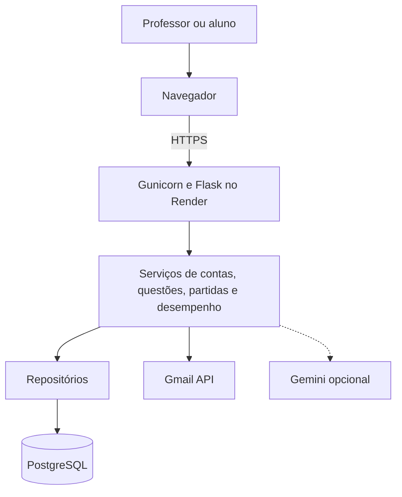

# TaskFlow Card

Aplicação web educacional de perguntas e respostas para os anos finais do ensino fundamental. O professor monta atividades por disciplina, e o aluno pratica contra um bot ou joga on-line com colegas.

## Sobre o projeto

O TaskFlow Card foi desenvolvido como Projeto Final de Curso do Bacharelado em Sistemas de Informação da Universidade de Mogi das Cruzes (UMC). A proposta usa partidas curtas, pontuação e feedback para apoiar a revisão dos conteúdos trabalhados em aula.

A entrega de **23/11/2026** foi publicada no Render com PostgreSQL. O painel do professor reúne os resultados das atividades e ajuda a identificar quais questões ou conteúdos merecem ser retomados em aula.

## Objetivos

- Permitir que professores cadastrem questões e organizem salas de diferentes disciplinas.
- Oferecer treino individual e partidas on-line para alunos com perfil escolar compatível com a sala.
- Validar o acesso, as respostas, a pontuação e o avanço das rodadas no servidor.
- Registrar participação, acertos, erros e aproveitamento para consulta pelo professor.
- Verificar os fluxos principais com testes locais e conferências na versão publicada.

## Como funciona o jogo

1. O professor cadastra questões com alternativas, resposta correta e feedback. Ao criar uma sala, escolhe a disciplina, o ano escolar, a turma, o período e a sequência das questões.
2. No primeiro acesso, o aluno informa seu nome, idade e classificação escolar. A área do aluno lista as salas compatíveis com o ano, a turma e o período e verifica mudanças a cada **um minuto**.
3. O aluno escolhe uma sala da lista e abre o **treino contra bot** ou uma **partida on-line** disponível naquela sala.
4. A questão vale um, dois ou três pontos conforme a dificuldade. O servidor corrige a resposta, calcula a pontuação e apresenta o feedback.

### Treino contra bot

O treino usa as questões ativas vinculadas à sala selecionada. A seleção prioriza questões ainda não respondidas e considera o histórico recente do aluno naquela sala. Com menos de três respostas, a preferência é por dificuldade média. Depois disso, a preferência passa a fácil quando o aproveitamento é inferior a 50%, média entre 50% e menos de 80%, e difícil a partir de 80%. O bot tem uma probabilidade de acerto definida por dificuldade. O aluno acompanha suas taxas de acertos e erros e pode reiniciar o histórico do modo individual.

### Partida on-line

O envio de respostas é liberado com pelo menos dois alunos na sala. Cada participante responde uma vez por rodada. Enquanto aguarda participantes ou respostas, o navegador atualiza a página em intervalos de aproximadamente **três segundos**. Quando a página recebe a informação de que todos responderam, aguarda **cinco segundos** e solicita o avanço. O servidor confere novamente o estado da rodada e as respostas antes de carregar a próxima questão ou encerrar a partida com o placar final.

Alterar o ano, a turma, o período ou a sequência de questões reinicia a partida e zera o placar. Alterações apenas no nome ou na disciplina preservam o progresso.

## Perfis de usuário

### Professor

- Cria a própria conta e confirma o cadastro com um código enviado ao Gmail.
- Cadastra, edita, pausa e organiza suas questões por tema e dificuldade.
- Cria salas, define a ordem das questões e consulta os alunos vinculados às suas salas.
- Consulta e assume salas ou questões que ficaram no acervo sem professor.
- Acompanha a participação e o desempenho nas suas salas e consulta os eventos de auditoria autorizados.
- Pode alterar a senha, recuperar o acesso pelo Gmail e excluir ou anonimizar a própria conta.

### Aluno

- Confirma o Gmail e informa a classificação escolar no primeiro acesso. O cadastro atende alunos de **10 a 15 anos**, do **6º ao 9º ano**, nos períodos **manhã**, **tarde** ou **integral**.
- Pode concluir o cadastro antes de uma sala compatível ser criada. A sala aparece em **Minha área** quando o sistema encontra a combinação correspondente.
- Pode acessar salas de diferentes disciplinas vinculadas ao mesmo ano, turma e período.
- Treina contra o bot, participa de partidas on-line, consulta o próprio desempenho e pode ouvir as questões.
- Pode alterar a senha, recuperar o acesso pelo Gmail ou excluir a própria conta em **Minha conta**.

### Painel de desempenho

O painel do professor mostra participação, aproveitamento, respostas, acertos, erros e faixas de desempenho. Os filtros incluem aluno, turma, sala, faixa de desempenho, modo de jogo, dificuldade, situação da conta e período. O filtro por modo permite consultar **somente o treino contra bot** ou **somente o multijogador**.

Os bimestres são pares de meses do calendário, a partir de **2026**, de janeiro–fevereiro a novembro–dezembro. O recorte usa o fuso de São Paulo. O painel e a tela de logs consultam os dados a cada **dez segundos** enquanto a página está visível.

## Arquitetura



O Flask renderiza páginas com Jinja e recebe formulários e requisições HTTP. Os controladores verificam a sessão e encaminham os dados aos serviços, que aplicam as regras de negócio. Os repositórios concentram as consultas e a gravação de dados. O JavaScript atualiza o estado da partida e dos painéis no navegador.

| Componente | Tecnologia |
| --- | --- |
| Interface | HTML, CSS, JavaScript e Jinja |
| Servidor | Python 3.13, Flask e Gunicorn |
| Persistência da entrega | PostgreSQL, com o driver Psycopg |
| Hospedagem | Render, com acesso por HTTPS |
| Integrações | Gmail API com OAuth 2.0 e Gemini opcional |
| Testes | `unittest`, com SQLite em cenários isolados. Há registros de integração da versão local anterior com MySQL. |

### Organização do código

| Caminho | Responsabilidade |
| --- | --- |
| `backend/app.py` e `backend/render_app.py` | Montam a aplicação Flask e expõem a entrada usada pelo Gunicorn. |
| `backend/taskflow/web.py` | Rotas, sessão, autorização, formulários e respostas HTTP. |
| `backend/taskflow/dominio.py` e `backend/taskflow/classificacao.py` | Entidades, validações e regras de classificação escolar. |
| `backend/taskflow/servico.py` e `backend/taskflow/servicos/` | Operações de contas, questões, salas, jogos e desempenho. |
| `backend/taskflow/gmail.py` e `backend/taskflow/gemini.py` | Implementação das integrações externas. |
| `banco_de_dados/esquema_postgres.sql` e `banco_de_dados/persistencia/` | Esquema relacional, consultas, migrações e operações de persistência. |
| `frontend/templates/` e `frontend/static/` | Telas Jinja, estilos, leitura em voz alta e atualização das páginas. |
| `render.yaml`, `requirements.txt` e `tests/` | Configuração da hospedagem, dependências e testes. |

## Modelo de dados

- `usuarios`, `perfil_aluno` e `aceites` guardam contas, classificação escolar e aceite dos documentos de uso e privacidade.
- `questoes` guarda enunciados, alternativas, gabarito e feedback. `questoes_sala_multijogador` associa as questões à sala e registra a ordem.
- `salas_multijogador`, `participantes_multijogador` e `respostas_multijogador` guardam a sala, a rodada, os participantes, as respostas e o placar.
- `tentativas` relaciona o desempenho do aluno à sala, ao modo de jogo e à questão respondida.
- `codigos_cadastro` e `tokens_recuperacao` registram a verificação por e-mail e as credenciais temporárias de recuperação em formato criptográfico.
- `auditoria` registra horário, perfil, evento, recurso e identificadores internos.

## Requisitos funcionais

| Requisito | Implementação |
| --- | --- |
| RF01 | Criar contas de professor e aluno com confirmação pelo Gmail. |
| RF02 | Autenticar e autorizar o acesso conforme o perfil. |
| RF03 | Concluir o primeiro acesso e preencher o perfil escolar do aluno. |
| RF04 | Consultar alunos vinculados às salas do professor. |
| RF05 | Gerenciar o banco de questões. |
| RF06 | Ouvir questões e consultar a disponibilidade da integração com IA. |
| RF07 | Treinar contra bot com as questões da sala selecionada. |
| RF08 | Criar e gerenciar salas on-line por disciplina. |
| RF09 | Escolher uma sala compatível e responder às rodadas. |
| RF10 | Avançar rodadas e encerrar a partida com o placar final. |
| RF11 | Consultar desempenho e eventos de auditoria conforme a autorização. |
| RF12 | Recuperar a senha e encerrar a própria conta. |

## Requisitos não funcionais

| Requisito | Implementação ou critério |
| --- | --- |
| RNF01 | Proteger senhas, códigos de cadastro e tokens de recuperação. |
| RNF02 | Criptografar nome e Gmail e localizar a conta por índice HMAC. |
| RNF03 | Validar sessão, vínculo com a aba e token CSRF nas operações de alteração. |
| RNF04 | Verificar o perfil e a autorização para cada recurso no servidor. |
| RNF05 | Assinar eventos de auditoria com Ed25519 e aplicar a retenção de 14 dias. |
| RNF06 | Hospedar com HTTPS, PostgreSQL e credenciais configuradas no servidor. |
| RNF07 | Manter os jogos e o cadastro manual de questões disponíveis sem IA e oferecer leitura com voz local quando disponível. |
| RNF08 | Disponibilizar os Termos de Uso e a Política de Privacidade no rodapé e registrar o aceite. |
| RNF09 | Conferir os fluxos críticos usando contas de teste na instalação da demonstração. |

## Segurança e privacidade

- As senhas são armazenadas com **PBKDF2-HMAC-SHA256** e sal aleatório. Os códigos de cadastro usam **HMAC** e os tokens de recuperação são armazenados como resumos **SHA-256**.
- Nome e Gmail são criptografados com **Fernet**. Um índice HMAC permite localizar o Gmail normalizado para autenticação.
- A aplicação limita tentativas de login, valida o token CSRF em formulários e usa cookies de sessão com `HttpOnly` e `SameSite=Lax`. Na URL HTTPS, a configuração também usa `Secure`. Fora das telas de partida, a sessão expira após **dez minutos de inatividade**.
- Os novos eventos de auditoria recebem assinatura **Ed25519**. O professor consulta suas próprias ações e os eventos de login e saída dos alunos vinculados às suas salas. O sistema remove eventos com mais de **14 dias** ao iniciar, registrar ou consultar a auditoria.
- A exclusão da própria conta exige a senha atual e confirmação escrita. A aplicação encerra a sessão e trata os vínculos pessoais dos registros. As salas e questões de um professor que encerra a conta podem ficar no acervo sem responsável.

## Acessibilidade

A interface usa layouts adaptáveis, campos com rótulos e indicação de foco nos formulários. As mensagens de atualização e de estado são anunciadas por regiões apropriadas da página. O botão **Ouvir questão** lê o enunciado e as alternativas no treino contra bot e no multijogador, quando o navegador e o dispositivo oferecem uma voz local em português.

## Integrações e hospedagem

O cadastro usa um código de **seis dígitos**, válido por **dez minutos**. Para recuperar a senha, a conta recebe um link de uso único válido por **30 minutos**. O envio dos dois tipos de mensagem usa a API do Gmail com autorização OAuth 2.0.

O Gemini pode auxiliar o professor na geração e adaptação de questões. O painel indica a disponibilidade da integração e mostra as operações bem-sucedidas registradas na instalação. A cota restante aparece como indisponível no painel. O professor revisa o conteúdo antes de usá-lo nas atividades.

A aplicação hospedada é descrita em `render.yaml`. Para usar a versão de demonstração, acesse a URL HTTPS do serviço web e escolha o perfil na página inicial.

| Variável de ambiente | Uso no servidor |
| --- | --- |
| `DATABASE_URL` | Conexão com o PostgreSQL da instalação. |
| `FLASK_SECRET_KEY` | Assinatura da sessão. |
| `TASKFLOW_DATA_KEY` | Chave Fernet usada para proteger os dados. |
| `TASKFLOW_AUDIT_SEED` | Semente privada usada para assinar os eventos de auditoria. |
| `TASKFLOW_GMAIL_CLIENT_ID`, `TASKFLOW_GMAIL_CLIENT_SECRET` e `TASKFLOW_GMAIL_REFRESH_TOKEN` | Credenciais OAuth da integração com Gmail. |
| `TASKFLOW_GMAIL_SENDER` | Gmail autorizado para enviar as mensagens. |
| `GEMINI_API_KEY` | Chave opcional para habilitar a integração com Gemini. |

O Render instala as dependências de `requirements.txt` e inicia o Gunicorn com `backend.render_app:app`. Os valores de configuração são fornecidos no ambiente do serviço.

## Plano de testes e resultados

A suíte local cobre regras de negócio, interface, segurança, desempenho e persistência. Para executar a descoberta dos testes a partir da raiz do projeto, use um ambiente de testes com as dependências de `requirements-dev.txt` instaladas.

```bash
python -m unittest discover -q
```

| Etapa | Evidência registrada |
| --- | --- |
| Verificação local de navegador | Cenário automatizado de uma versão anterior com um professor e dois alunos, incluindo criação da sala, respostas e avanço de rodada. |
| Suíte local de 16/11/2026 | 137 testes identificados, com 115 aprovados e 22 ignorados por exigirem configuração separada. |
| Cobertura local de 16/11/2026 | 78,9% por linhas nos módulos Python do backend e da persistência, com 3.617 de 4.587 linhas contabilizadas executadas. |
| Verificação manual no Render | Confirmação de cadastro por Gmail, recuperação de senha, partida on-line e exclusão da própria conta. |

A cobertura se refere ao código avaliado no ambiente local em 16/11. As verificações no Render registram o funcionamento dos fluxos demonstrados. A avaliação pedagógica com uma turma real ficou como etapa futura.

## Autores

- Jonathas Eduardo Santos Ramos
- José Armando Abrão Boer

**Orientador** — Prof. Pedro Henrique Miho de Souza  
**Coorientador** — Prof. Alessandro Aparecido da Silva Hora  
**Instituição** — Universidade de Mogi das Cruzes (UMC), Bacharelado em Sistemas de Informação

## Referências principais

- [Base Nacional Comum Curricular — Ministério da Educação](https://basenacionalcomum.mec.gov.br/images/BNCC_EI_EF_110518_versaofinal_site.pdf)
- [Lei Geral de Proteção de Dados Pessoais — Lei nº 13.709/2018](https://www.planalto.gov.br/ccivil_03/_ato2015-2018/2018/lei/l13709compilado.htm)
- [Documentação do Flask](https://flask.palletsprojects.com/en/stable/)
- [Publicação de aplicações Flask no Render](https://render.com/docs/deploy-flask)
- [Envio de mensagens pela API do Gmail](https://developers.google.com/workspace/gmail/api/guides/sending)
- [Referência da API Gemini](https://ai.google.dev/api)
